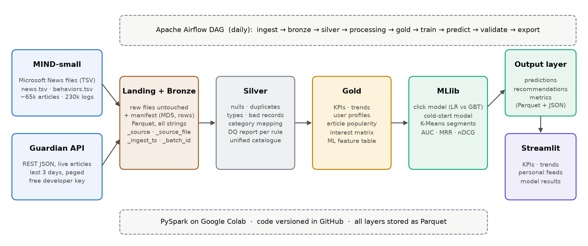

# Personalized News Recommendation System using Big Data

An end-to-end big-data pipeline that learns what each reader likes from real news-click logs and
recommends articles to them, including brand-new articles pulled live from a news API.



| Layer | What happens | Tech |
|---|---|---|
| Sources | **MIND-small** click logs (TSV files) + **The Guardian Open Platform** (REST API, JSON) | `requests` |
| Landing | raw files untouched + manifest (MD5, size, rows, URL, time) | JSON manifest |
| Bronze | raw data as Parquet, all strings, lineage columns `_source`, `_source_file`, `_ingest_ts`, `_batch_id` | PySpark |
| Silver | nulls, duplicates, types, inconsistent values, invalid records; DQ report per rule | PySpark |
| Processing | filter, joins, aggregations, Spark SQL, window functions | PySpark / Spark SQL |
| Gold | KPIs, trends, user profiles, article popularity, interest matrix, ML features | PySpark |
| ML | click classifier (Logistic Regression vs GBT), cold-start model, K-Means segments | Spark MLlib |
| Output | predictions, top-10 recommendations, metrics (AUC, MRR, nDCG@5/10) | Parquet + JSON |
| Dashboard | KPIs, trends, personalised feeds, model results, segments, data quality | Streamlit + Plotly |
| Orchestration | daily DAG with 9 tasks | Apache Airflow |

## Quick start (Google Colab, recommended)
1. Get a free Guardian API key: <https://open-platform.theguardian.com/access/>
2. Open `notebooks/NewsRec_BigData_Pipeline.ipynb` in [Google Colab](https://colab.research.google.com/) (File → Upload notebook).
3. Add the key in Colab's 🔑 **Secrets** panel as `GUARDIAN_API_KEY` (turn on notebook access).
4. `Runtime → Run all`. Takes about 30–45 minutes.

## Run locally (Java 11/17 + Python 3.10–3.12)
```bash
pip install -r requirements.txt
export GUARDIAN_API_KEY=your_key
python run_all.py                 # steps 2 -> 10, same order as the Airflow DAG
streamlit run dashboard/app.py    # dashboard on http://localhost:8501
```

## Airflow
```bash
export NEWSREC_HOME=$(pwd) AIRFLOW__CORE__DAGS_FOLDER=$(pwd)/dags
airflow db migrate
airflow dags test news_recsys_pipeline     # one full run
airflow standalone                         # web UI on :8080
```

## Repository layout
```
pipeline/   common.py + one script per step (step02_ingest ... step10_validate)
dags/       news_recsys_dag.py (Airflow)
dashboard/  app.py (Streamlit) + data/ (exported real outputs the dashboard reads)
notebooks/  NewsRec_BigData_Pipeline.ipynb (runs everything on Colab)
docs/       architecture diagram
```
`data/` (landing/bronze/silver/gold/models/output) is rebuilt by the pipeline and is git-ignored.

## Data sources & licences
- **MIND**: Microsoft News Dataset, Wu et al., *MIND: A Large-scale Dataset for News Recommendation*, ACL 2020. <https://msnews.github.io/>. Free for non-commercial research under the Microsoft Research License Terms.
- **The Guardian Open Platform**: <https://open-platform.theguardian.com/>. Free developer key, for non-commercial use.
